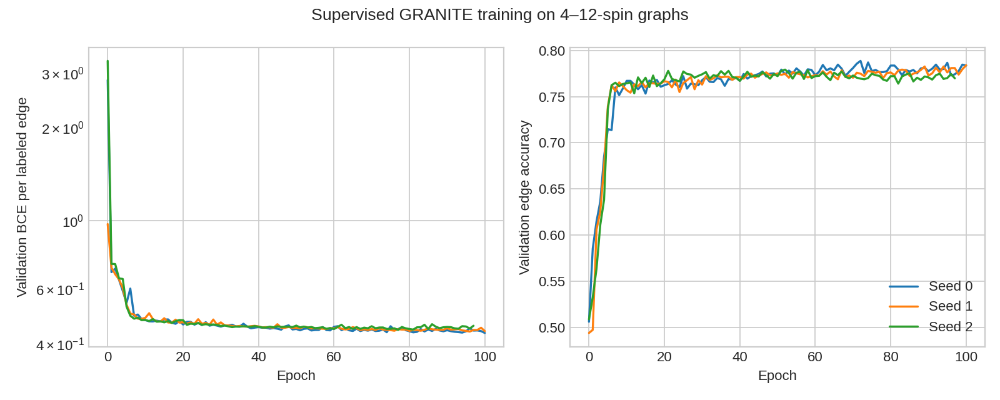
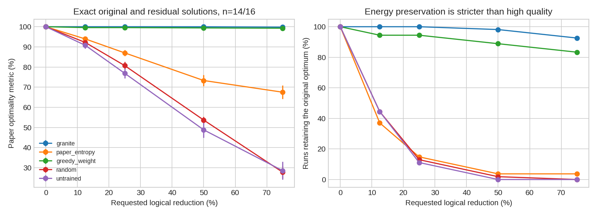
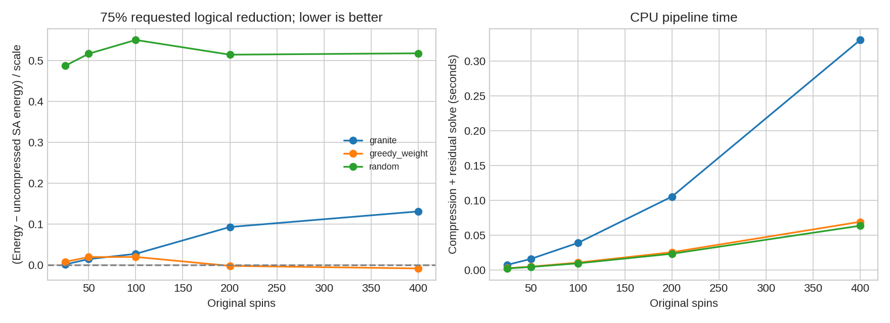

# Measured GRANITE reproduction results

This is a classical CPU reproduction of the compression algorithm. No D-Wave sampling, minor embedding, physical-qubit reduction or quantum advantage was measured.

## Training

| Seed | Initial validation accuracy | Best-checkpoint accuracy | Best epoch | Epochs | Training seconds |
|---|---:|---:|---:|---:|---:|
| 0 | 0.506 | 0.784 | 100 | 100 | 10.39 |
| 1 | 0.494 | 0.781 | 96 | 100 | 10.35 |
| 2 | 0.509 | 0.772 | 77 | 97 | 10.08 |

## Held-out edge classification (14/16 spins)

| Method | Pooled labeled-edge accuracy | First highest-confidence edge safe fraction |
|---|---:|---:|
| granite | 0.8015 | 1.0000 |
| untrained | 0.4927 | 0.6481 |
| loss_bce | 0.7988 | 1.0000 |
| loss_mse | 0.8048 | 0.9444 |
| loss_softmax | 0.7012 | 1.0000 |
| depth_1 | 0.7928 | 1.0000 |
| depth_2 | 0.8008 | 0.9444 |
| depth_4 | 0.8108 | 1.0000 |
| depth_5 | 0.8207 | 1.0000 |
| width_2 | 0.7988 | 1.0000 |

## Compression quality with exact residual solves

Each residual problem is solved exactly, isolating compression loss from solver error. Means average model seeds within each graph before averaging the 18 test graphs. Error bars are one SEM across graphs, not 95% confidence intervals.

| Method | Requested reduction | Mean optimality ± SEM (%) | Optimum preserved fraction |
|---|---:|---:|---:|
| granite | 12.5% | 100.00 ± 0.00 | 1.000 |
| granite | 25% | 100.00 ± 0.00 | 1.000 |
| granite | 50% | 99.98 ± 0.02 | 0.981 |
| granite | 75% | 99.80 ± 0.12 | 0.926 |
| paper_entropy | 12.5% | 93.93 ± 1.04 | 0.370 |
| paper_entropy | 25% | 87.01 ± 1.50 | 0.148 |
| paper_entropy | 50% | 73.31 ± 2.78 | 0.037 |
| paper_entropy | 75% | 67.51 ± 3.32 | 0.037 |
| greedy_weight | 12.5% | 99.56 ± 0.44 | 0.944 |
| greedy_weight | 25% | 99.56 ± 0.44 | 0.944 |
| greedy_weight | 50% | 99.40 ± 0.46 | 0.889 |
| greedy_weight | 75% | 99.26 ± 0.47 | 0.833 |
| random | 12.5% | 92.19 ± 1.25 | 0.444 |
| random | 25% | 80.69 ± 1.89 | 0.130 |
| random | 50% | 53.70 ± 1.64 | 0.019 |
| random | 75% | 27.84 ± 2.96 | 0.000 |
| untrained | 12.5% | 90.77 ± 1.60 | 0.444 |
| untrained | 25% | 76.87 ± 2.46 | 0.111 |
| untrained | 50% | 48.84 ± 3.87 | 0.000 |
| untrained | 75% | 28.60 ± 4.41 | 0.000 |

## Loss, depth and width ablations

All controls below use training seed 0 and the same data. The baseline in this table is also seed 0. Checkpoint selection uses each run’s validation objective. These are small-sample controls, not a recreation of the paper’s QPU ablation tables.

| Configuration | Validation accuracy | 75% reduction optimality (%) | Optimum preserved fraction |
|---|---:|---:|---:|
| hybrid_depth3_width16 | 0.7836 | 99.78 | 0.889 |
| depth_1 | 0.7718 | 100.00 | 1.000 |
| depth_2 | 0.7704 | 99.92 | 0.944 |
| depth_4 | 0.7839 | 99.86 | 0.944 |
| depth_5 | 0.7917 | 100.00 | 1.000 |
| loss_bce | 0.7893 | 99.90 | 0.944 |
| loss_mse | 0.7856 | 99.41 | 0.833 |
| loss_softmax | 0.6567 | 99.40 | 0.944 |
| width_2 | 0.7684 | 99.98 | 0.944 |

## Larger instances: classical solver only

The reference is an uncompressed simulated-annealing run, NOT the optimum. Negative gaps mean a compressed run beat that heuristic reference. No optimality percentage is computed for these instances.

| Original spins | Method | 75% reduction normalized gap to SA | Mean pipeline seconds |
|---|---|---:|---:|
| 25 | granite | 0.0017 | 0.0075 |
| 25 | greedy_weight | 0.0081 | 0.0027 |
| 25 | random | 0.4865 | 0.0024 |
| 50 | granite | 0.0147 | 0.0160 |
| 50 | greedy_weight | 0.0198 | 0.0050 |
| 50 | random | 0.5161 | 0.0045 |
| 100 | granite | 0.0276 | 0.0389 |
| 100 | greedy_weight | 0.0200 | 0.0107 |
| 100 | random | 0.5497 | 0.0097 |
| 200 | granite | 0.0931 | 0.1055 |
| 200 | greedy_weight | -0.0018 | 0.0256 |
| 200 | random | 0.5138 | 0.0234 |
| 400 | granite | 0.1311 | 0.3303 |
| 400 | greedy_weight | -0.0081 | 0.0693 |
| 400 | random | 0.5171 | 0.0637 |

## Interpretation

- `granite` selects the most confident edge, following the prose. `paper_entropy` follows the maximum-entropy selection printed in Algorithm 1. This is an explicit ambiguity comparison, not a silent correction.
- High individual-edge classification accuracy does not guarantee safe repeated contraction. Earlier errors restrict subsequent possibilities, and residual graphs differ from the training distribution.
- `greedy_weight` satisfies the largest-magnitude residual edge and is an important inexpensive control. Its strength limits any claim that learning is necessary on these synthetic graphs.
- Reduction is the fraction of logical augmented vertices removed, rounded to an integer target. Edge counts are recorded separately. Neither quantity is a measurement of physical qubits.
- The large-graph solver uses 16 Metropolis chains and 40 sweeps, then local polish. Fixed reads/sweeps are not fixed wall time; compression and solver times are recorded separately.
- Original paper training used much larger labeled data, and its experiments used D-Wave and Gurobi. Here training uses 720 graphs plus 180 validation graphs, all 4–12 spins; exact tests hold out both seeds and sizes.

Artifacts: [exact CSV](exact.csv), [large CSV](large.csv), [classification CSV](classification.csv), [instances](instances.npz), [traces and solutions](solutions.json), [protocol](protocol.json), [verification](verification.json).
